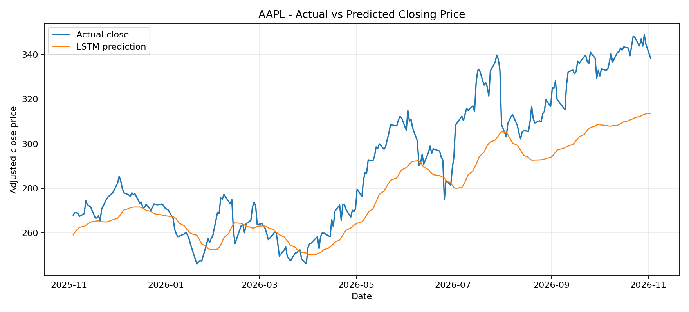
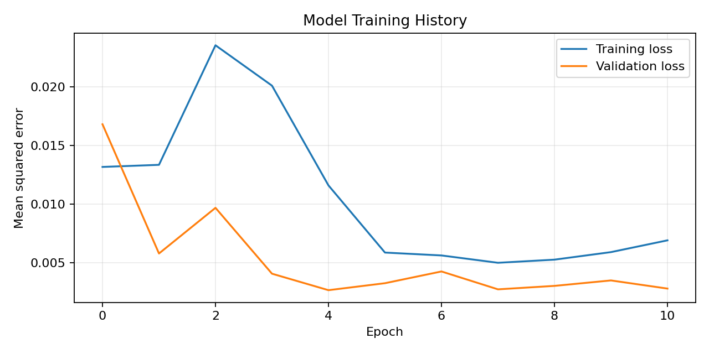
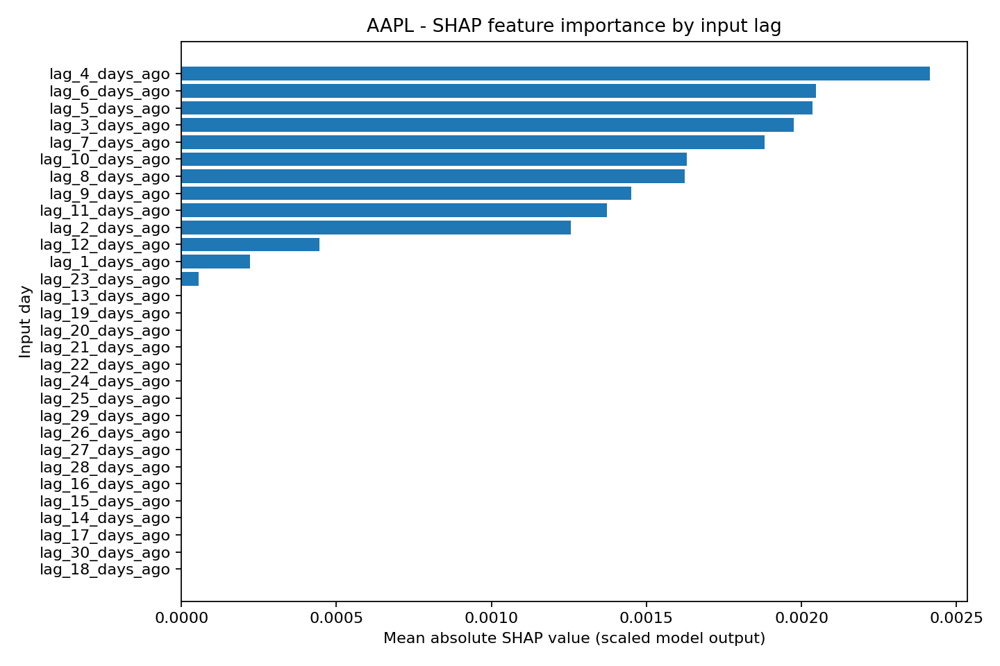

# Stock Price Prediction using LSTM and Explainable AI (SHAP)

**A student learning project | Python, TensorFlow/Keras, LSTM, SHAP, Pandas**

This project explores whether an LSTM neural network can learn patterns from historical daily closing prices. It downloads market data, trains a model, compares it with a simple previous-day baseline, saves evaluation results, and uses SHAP to inspect which input days influenced selected model predictions.

> **Disclaimer:** This is an educational machine-learning project, not financial advice. Historical patterns do not guarantee future returns. Model outputs should not be used as the only basis for investment decisions.

## Project objectives

- Understand how time-series data can be prepared for an LSTM.
- Train and evaluate a small recurrent neural network.
- Compare the model against a simple persistence baseline.
- Visualise predictions and training loss.
- Explore model explanations using SHAP.

## Tools and libraries

- Python 3.10+
- TensorFlow / Keras
- yfinance and Pandas
- NumPy, Matplotlib and scikit-learn
- SHAP

## Repository structure

```text
.
├── src/
│   ├── train.py          # Download data, train LSTM, evaluate and plot
│   └── explain.py        # Explain recent model predictions with SHAP
├── results/
│   └── README.md         # Description of generated result files
├── artifacts/
│   └── .gitkeep          # Trained model files are generated locally
├── requirements.txt
└── .gitignore
```

## Setup on Windows

Open Command Prompt or the VS Code terminal in the project folder.

```bash
py -m venv .venv
.venv\Scripts\activate
python -m pip install --upgrade pip
pip install -r requirements.txt
```

If the `py` command is not available, try `python` instead.

## Step 1: Train and evaluate the model

Example using Apple historical prices:

```bash
python src/train.py --ticker AAPL --period 5y
```

You can try another Yahoo Finance ticker:

```bash
python src/train.py --ticker MSFT --period 5y
```

The training script:
1. Downloads adjusted daily closing prices.
2. Uses the first 80% of observations for training and the later 20% for testing.
3. Fits the scaler using training data only.
4. Creates input sequences from the previous 30 trading days.
5. Trains an LSTM with early stopping.
6. Evaluates the test set using MAE and RMSE.
7. Compares the LSTM with a previous-day closing-price baseline.

## Step 2: Generate SHAP explanations

Run this after training the same ticker:

```bash
python src/explain.py --ticker AAPL
```

The SHAP script uses KernelExplainer on flattened 30-day input windows. It saves a CSV and a horizontal bar chart showing mean absolute SHAP values for each lag day. The calculation may take a few minutes.

**How to read the chart:** A larger mean absolute SHAP value means that input lag had a larger influence on the model output for the selected examples and background data. It does not show a real-world cause of a stock movement.

## Generated results

After running the scripts, check the `results/` folder:

| File | Description |
|---|---|
| `<ticker>_actual_vs_predicted.png` | Actual test prices compared with LSTM predictions |
| `<ticker>_training_loss.png` | Training and validation loss |
| `<ticker>_predictions.csv` | Date-wise actual, LSTM and baseline values |
| `<ticker>_metrics.json` | Test MAE and RMSE for model and baseline |
| `<ticker>_shap_importance.png` | SHAP importance by input lag |
| `<ticker>_shap_importance.csv` | SHAP importance values |

The result files are generated when the project is run. **No sample accuracy or metric values are claimed here** because results depend on the ticker, downloaded date range, software versions and training run. Commit your own generated charts and metrics after checking them.

## Evaluation metrics

- **MAE (Mean Absolute Error):** average absolute difference between actual and predicted prices. Lower is better.
- **RMSE (Root Mean Squared Error):** gives larger errors more weight. Lower is better.

The previous-day baseline is included because a neural network should be compared with a simple reference method, not judged by its graph alone.

## Current limitations

- Uses only historical closing prices; it does not include company news, financial statements or macroeconomic information.
- A random-free chronological holdout is used, but this is not a full walk-forward backtest.
- The model is a learning experiment and may not outperform the baseline.
- SHAP explanations describe the model's behaviour, not causal market factors.
- Yahoo Finance data availability and package compatibility may change.

## Ideas for future improvements

- Add volume and technical indicators as extra features.
- Compare LSTM with ARIMA and other baseline models.
- Add walk-forward validation.
- Build a small Streamlit dashboard.
- Test additional tickers and record results in a comparison table.

## What I learned

This project is intended to practise Python, data preprocessing, sequence modelling, model evaluation, plotting and basic explainable AI. I am continuing to improve the code and understand each step.

## Author

**Srujan S**  
GitHub: [@srujanddk28](https://github.com/srujanddk28)


## Live graphs and model results on GitHub

The repository includes an automated GitHub Actions workflow that trains the AAPL model, evaluates it against the previous-day baseline, creates prediction and training-loss charts, and generates a SHAP feature-importance chart. When the workflow completes successfully, it publishes the generated charts, prediction CSV and evaluation metrics into `results/`.

### Latest generated charts







### Latest prediction data and evaluation

- [Date-wise predictions (CSV)](results/aapl_predictions.csv)
- [Evaluation metrics (JSON)](results/aapl_metrics.json)
- [SHAP importance values (CSV)](results/aapl_shap_importance.csv)

**Note:** These images and files appear after the automated training workflow finishes successfully. The charts are generated from downloaded historical market data and a newly trained model; they are historical test-set evaluation, not guaranteed future prices or financial advice. Open the repository's **Actions** tab to check the workflow status.
